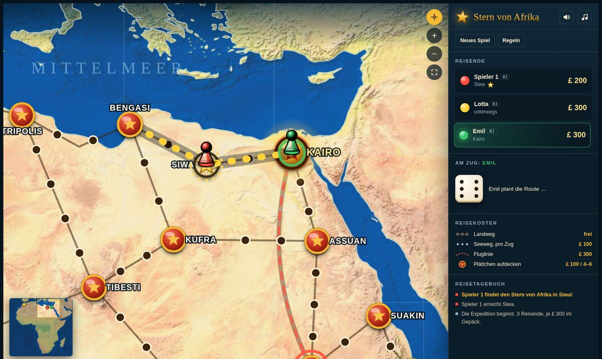
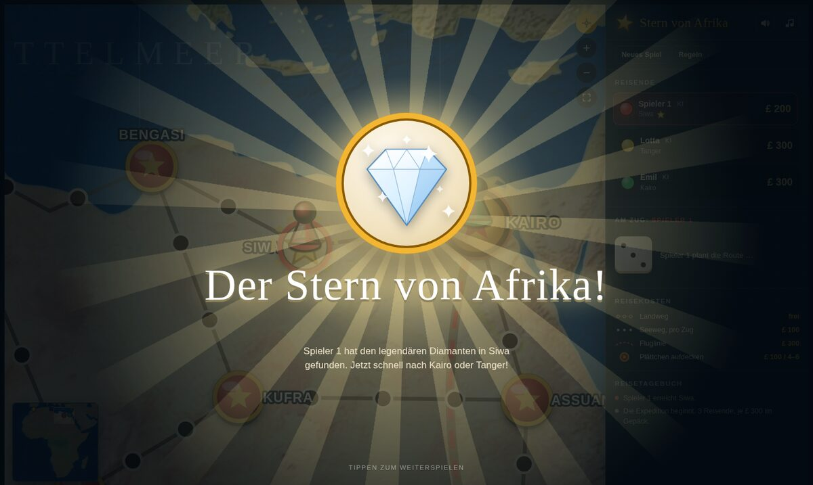
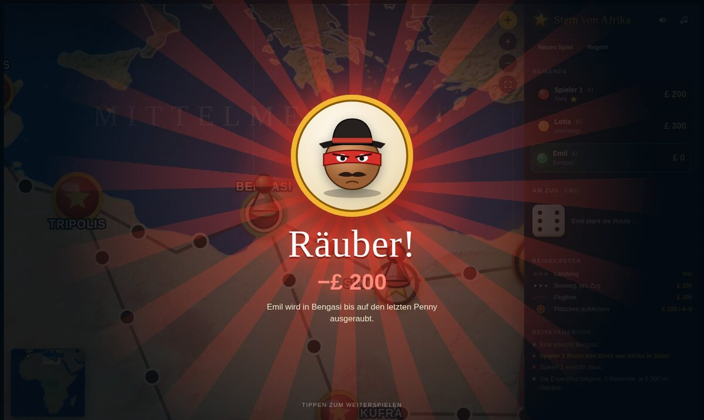
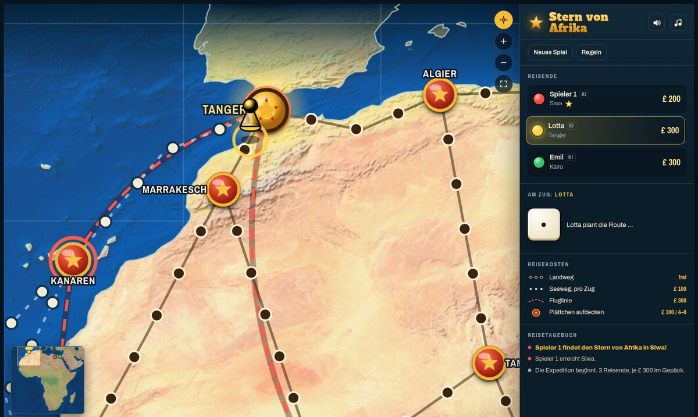
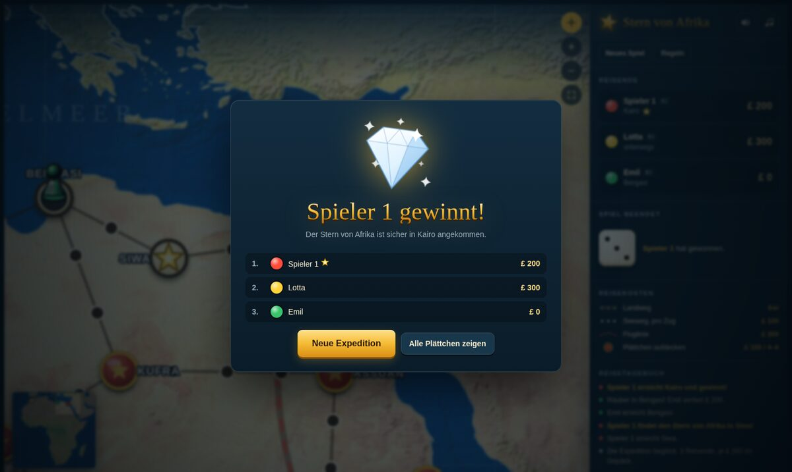

<div align="center">

# ⭐ Der Stern von Afrika

**Der Brettspielklassiker als Browserspiel, mit echter Reliefkarte, Kamerafahrten, 3D-Würfel, Sound und viel Glitzer.**

### [▶ Jetzt spielen](https://schneipp.github.io/stern-von-afrika/)

2–5 Spieler · am selben Gerät oder gegen den Computer · als App auf iPad, iPhone und Android installierbar



</div>

## Worum geht's?

Irgendwo zwischen Tanger und Kapstadt liegt unter einem von 46 Plättchen der **Stern von Afrika**, der größte Diamant der Welt. Alle starten mit £ 300 in Kairo oder Tanger und reisen über Wüstenpisten, Seewege und Fluglinien durch den Kontinent. Unterwegs gibt es Rubine, Smaragde und Topase zu finden, und Räuber, die einem die Reisekasse leeren.

Wer den Stern findet, muss ihn heim nach Kairo oder Tanger bringen. Sobald er aber gefunden ist, kann ihn noch jeder schlagen, der ein **Hufeisen** besitzt und zuerst ankommt.

<table>
<tr>
<td width="50%"></td>
<td width="50%"></td>
</tr>
<tr>
<td align="center"><sub>Fanfare, Konfetti, Funkenregen: der Stern ist gefunden</sub></td>
<td align="center"><sub>Pech gehabt: der Räuber nimmt alles mit</sub></td>
</tr>
</table>

## Das steckt drin

- 🗺️ **Echte Reliefkarte von Afrika** auf Basis von Natural Earth, farblich angepasst, mit 48 Städten und den echten Küstenlinien
- 🌟 **Animierter Vorspann:** Sternenhimmel, einfliegender Stern mit Lichtstrahlen und Logo; beim Start erklingt eine Fanfare. Ist noch ein Spiel gespeichert, geht es direkt mit „Weiterspielen“ zurück
- 👆 **Aktionen direkt an der Figur:** Würfeln, Aufdecken, Fliegen und Co. erscheinen als Sprechblase an der Spielfigur auf der Karte, beim Zielwählen zeigt ein Hinweis oben, was zu tun ist
- 🎬 **Stadtfilm bei Ankunft:** kommt eine Figur in einer Stadt an, fährt die Kamera über eines von fünf echten Fotos des Ortes, dazu ein zufälliger „Wusstest du?“-Fakt (240 Fotos, 240 Fakten; antippen überspringt, abschaltbar über den Kamera-Knopf oben)
- 🎥 **Kamera fährt mit:** zoomt nach dem Würfeln auf die Ziele, folgt der hüpfenden Figur und fährt beim Aufdecken nah ran. Selbst steuern geht mit Ziehen, Mausrad, zwei Fingern oder über die Minimap
- 🎲 **3D-Würfel**, der aufs Brett fällt und ausrollt
- 💎 **Große Funde:** jedes Plättchen dreht sich mitten im Bild um, mit Lichtstrahlen, Partikeln und hochzählendem Gewinn
- ✈️ **Flugzeug und Schiff:** Flüge als animierter Bogen mit Schatten, auf See sitzt die Figur im Boot
- 🔊 **Sound und Musik**, komplett im Browser erzeugt: Würfelklappern, Schritte, Schiffshorn, Fanfaren und Kalimba-Musik im Hintergrund
- 🤖 **Computergegner** für beliebig viele Plätze
- 💾 **Spielstand bleibt erhalten**, auch nach einem Neuladen
- 📱 **Als App installierbar (PWA)**, läuft danach auch offline, im Vollbild und ohne Browserleiste
- 👆 **Für Touch gebaut:** große Tippflächen, Pinch-Zoom auf der Karte, eigenes Layout für iPad hoch und quer, Rücksicht auf Notch und Home-Balken, Bildschirm bleibt während des Spiels an



## Als App installieren

| Gerät | So geht's |
|---|---|
| **iPad / iPhone** | [Spiel](https://schneipp.github.io/stern-von-afrika/) in Safari öffnen → Teilen-Symbol → **„Zum Home-Bildschirm“** |
| **Android** | In Chrome öffnen → Menü → **„App installieren“** (oder der Download-Knopf oben im Spiel) |
| **Desktop (Chrome, Edge)** | Installieren-Symbol in der Adressleiste oder der Download-Knopf oben im Spiel |

Nach dem ersten Start ist alles im Gerät gespeichert, das Spiel läuft dann auch ohne Internet. Hinweis für iOS: Ist der Stummschalter am Gerät aktiv, bleibt auch das Spiel stumm.

## Regeln in Kürze

| | |
|---|---|
| **Start** | £ 300, wahlweise in Kairo oder Tanger |
| **Reisen** | Würfeln und genau so weit ziehen. Eine Stadt mit verdecktem Plättchen beendet den Zug. |
| **Kosten** | Landwege frei · Seewege £ 100 pro Zug · Flug £ 300 (von Städten mit rotem Ring) |
| **Aufdecken** | Sofort für £ 100, oder im nächsten Zug würfeln: bei 4, 5 oder 6 gratis |
| **Plättchen** | 1 Stern · 5 Hufeisen · 3 Räuber · 3 Rubine (£ 1000) · 4 Smaragde (£ 600) · 6 Topase (£ 300) · Rest leer |
| **Sieg** | Stern nach Kairo oder Tanger bringen, oder nach dem Fund mit einem Hufeisen zuerst dort sein |
| **Inselregel** | Wer pleite auf einer Insel festsitzt, fährt kostenlos mit dem Schiff weiter |

**Tastatur:** Leertaste oder Enter löst die Hauptaktion aus (Würfeln, Aufdecken …).

<div align="center"></div>

## Selbst starten

Kein Build, keine Abhängigkeiten, alles steckt in einer HTML-Datei.

```bash
git clone https://github.com/schneipp/stern-von-afrika.git
cd stern-von-afrika
python3 -m http.server 8000        # dann http://localhost:8000 öffnen
```

Die Seite lässt sich auch direkt per Doppelklick auf `index.html` öffnen. Nur die Installation als App und der Offline-Modus brauchen einen Webserver.

| Datei | Inhalt |
|---|---|
| `index.html` | Das Spiel (aktuelle Version), alles in einer Datei |
| `stern-von-afrika-relief.jpg` | Die Reliefkarte, muss neben der HTML-Datei liegen |
| `manifest.webmanifest`, `sw.js`, `icons/` | App-Installation und Offline-Cache |
| `stern-von-afrika.html` | Version 1 mit gezeichneter Karte, schlicht und schnell |
| `stern-von-afrika-v2.html` | Weiterleitung für alte Links |

## Hinweise

Eine Fan-Umsetzung von *Afrikan tähti* (Kari Mannerla, 1951). Städte, Wege und Plättchenverteilung sind an das Original angelehnt, aber frei gestaltet. Kein offizielles Produkt.

Kartendaten: [Natural Earth](https://www.naturalearthdata.com/), gemeinfrei. Stadtfotos: [Wikimedia Commons](https://commons.wikimedia.org/), Urheber und Lizenz (CC BY, CC BY-SA, CC0, FAL, gemeinfrei) werden im Spiel bei jedem Foto angezeigt und sind in `index.html` (`CITY_PHOTOS`) hinterlegt. Schriften: Alfa Slab One, Archivo und Archivo Narrow über Google Fonts.
